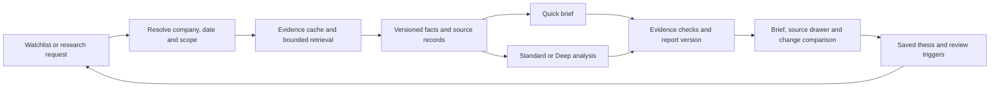

# Crossclock product and research-speed plan

Created: 13 October 2026 (Asia/Calcutta)  
Baseline reviewed: `4b2a3f781fdda6cb3a7594c3191122d4fe5b6836`  
Progress: [progress.md](progress.md)  
First commitment: a ten-working-day measurement and improvement sprint, starting when implementation begins

## Recommendation

Make Crossclock a research workspace that helps a user understand a company, verify the evidence and keep track of what changed. The most valuable improvement is a short, useful answer early, followed by deeper analysis when needed. Optimize both the time the software spends researching and the time the user spends reading and checking it.

Prioritize these changes:

1. Measure where time and money go; bound retries and stalled work.
2. Fetch evidence once, reuse it across analysts and display its freshness.
3. Offer Quick, Standard and Deep research with explicit coverage and budgets.
4. Lead reports with a source-linked brief, important disagreements and missing evidence.
5. Turn repeat research into a review of changes, supported by thesis tracking and useful alerts.

The initial user hypothesis is a self-directed investor maintaining an NSE watchlist, with US equities retained as a second validation cohort and for the 129BOB connection. This follows the existing India screener investment; it is a planning assumption, not customer validation. Start with the current local application. Public hosting, team accounts and broader market expansion follow evidence of demand.

Crossclock is the product name used here. The repository still identifies itself as TradingAgents-Jev and its Python package/command is `tradingagents`; renaming imports or CLI commands is not part of this plan.

## Existing foundation

These findings come from source inspection, not a fresh test run or live performance benchmark.

| Capability already present | Repository evidence | Build on it by adding |
| --- | --- | --- |
| Four analysts run concurrently; research and risk discussions follow | [Graph setup](../tradingagents/graph/setup.py), [analyst execution](../tradingagents/graph/analyst_execution.py) | Better data reuse and shorter critical paths; analyst parallelism is already implemented |
| Separate quick/deep model tiers, configurable reasoning, output caps and round limits | [Defaults](../tradingagents/default_config.py), [LLM clients](../tradingagents/llm_clients/) | User-facing research modes and measured per-stage budgets |
| Checkpoint/resume and graph configuration signatures | [Trading graph](../tradingagents/graph/trading_graph.py), [checkpointer](../tradingagents/graph/checkpointer.py) | Durable job history, explicit resume controls and evidence-aware invalidation |
| Live progress, call/token counters, elapsed time and analyst wall-time tracking | [Jobs](../cli/webui/jobs.py), [stats](../cli/stats_handler.py) | Persisted traces, queue time, retrieval/retry breakdowns, cost and first-useful-result timing |
| OHLCV/SEC caches and an India SQLite data layer | [OHLCV](../tradingagents/dataflows/vendors/yahoo/ohlcv.py), [SEC](../tradingagents/dataflows/vendors/sec_edgar.py), [India](../tradingagents/dataflows/vendors/india/) | Shared evidence records, in-flight request deduplication and change-based invalidation |
| Company pages, screens, custom ratios, peers, watchlists, holdings and exports | [Screener modules](../tradingagents/screener/), [web API](../cli/webui/server.py) | Comparable research briefs, natural-language query drafts and portfolio impact explanations |
| Price, metric, screen, filing and shareholding alerts with deduplication | [Alerts](../tradingagents/screener/alerts.py) | Thesis-change alerts and a ranked digest; basic alerts are already implemented |
| Jev sentiment judgments, concurrent judgment requests, debate convergence and final claim checks | [Jev](../tradingagents/agents/jev.py), [claim checks](../tradingagents/agents/claim_check.py), [use cases](jev-use-cases.md) | Original-source provenance and explicit check coverage; report agreement alone does not verify a fact |
| Saved Markdown/HTML reports, backtests and decision memory | [Reporting](../tradingagents/reporting.py), [backtest](../tradingagents/backtest.py), [memory](../tradingagents/memory/) | Immutable report versions, evidence comparisons and forward research-quality evaluation |

## External research and implications

Sources below were checked on 13 October 2026. Product pages establish advertised capabilities, not independently verified quality or customer demand. The Crossclock recommendations are inferences from these sources and the repository review.

| Reference | Observation | Implication for Crossclock |
| --- | --- | --- |
| [Screener features](https://www.screener.in/features/) | Company financials, custom screens, peers, watchlists, filing feeds and exports already form an established research workflow | Compete on evidence, speed and continuity of research; reproducing another screener is unlikely to be enough |
| [AlphaSense research workflow](https://www.alpha-sense.com/solutions/generative-ai-in-market-research/) | Advertises source-cited answers and deeper document research | Make each important conclusion inspectable and allow follow-up questions within the evidence already collected |
| [Alpha Spread watchlists](https://www.alphaspread.com/dashboard/watchlists) | Connects saved ideas with entry points and monitoring | Link research to a user's recorded thesis and review triggers, extending existing watchlists |
| [TradingAgents paper](https://arxiv.org/abs/2412.20138) | Describes specialist analysts, bull/bear discussion and risk roles | Preserve the full workflow as a baseline, then test whether each additional stage improves research quality enough to justify its cost; paper results do not establish this fork's performance |
| [LangGraph streaming](https://docs.langchain.com/oss/python/langgraph/streaming) and [persistence](https://docs.langchain.com/oss/python/langgraph/persistence) | Support incremental outputs and recoverable graph state | Extend the existing progress/resume implementation instead of replacing the orchestration framework |
| [Claude prompt caching](https://platform.claude.com/docs/en/build-with-claude/prompt-caching) | Reusable prefixes must match exactly; caching does not accelerate output-token generation | Put stable instructions first, measure cache hits, and shorten generated reports independently |
| [Google latency guidance](https://docs.cloud.google.com/gemini-enterprise-agent-platform/models/deploy/consumption-options#latency) | Distinguishes first-token and completion latency; recommends suitable models and concise input/output | Measure first useful evidence separately from final completion; model selection and output length should be experiments |
| [SEC EDGAR APIs](https://www.sec.gov/search-filings/edgar-application-programming-interfaces) | Offers submissions/XBRL APIs and nightly bulk archives for large retrievals | Extend the existing SEC adapter with local indexing and incremental refresh; use bulk ingestion only when universe size justifies it |
| [NSE data policy](https://www.nseindia.com/static/market-data/nse-data-policy) | Data use and redistribution depend on the relevant agreements | Before a hosted product, record which feeds permit storage, display and redistribution; website availability alone is not the deployment decision |

No competitor account was purchased, no customer was contacted and no paid model benchmark was run during this planning task.

## User experience and feature priorities

The main journey should be **find a company -> see a brief -> inspect evidence -> compare -> save a thesis -> review changes**. Keep analyst-by-analyst activity available as an expandable detail view.

| Priority / feature | User benefit and proposed behavior | Scope and acceptance | Delivery task |
| --- | --- | --- | --- |
| P0: concise research brief | Show business overview, key developments, supporting/opposing evidence, risks and next review trigger | Important factual statements link to evidence; show analysis date, source dates, currency/units, coverage and missing inputs; a partial brief is visibly partial | C05 |
| P0: research modes and run controls | Choose the depth needed, understand likely wait/cost and stop or resume a run | Show coverage and budget before starting; make provider failure, queueing and active work distinguishable; estimates come from comparable measured runs | C03, C06 |
| P0: evidence drawer | Verify a statement without searching elsewhere | Open original URL/document location plus excerpt, publication/fetch time and calculation inputs; mark support, contradiction and unknown separately | C04, C05 |
| P1: "What changed since my last review?" | Avoid reading the same report repeatedly | Compare versioned facts and sources, explain rating/thesis changes, and show unchanged sections as reused; distinguish model/config changes from new company evidence | C08 |
| P1: thesis notebook and digest | Save why a company matters, what would invalidate the idea and when to revisit it | Extend watchlist notes/alerts with linked evidence, materiality, cooldowns and a daily/weekly digest; users select delivery and can mute it | C10 |
| P1: filing and earnings-call Q&A | Answer focused questions from collected documents | Begin with SEC filings and available NSE/company documents; add transcripts only with a usable source/access path; answers cite passages or say evidence is missing | C09 |
| P1: side-by-side research and portfolio impact | Compare 2-4 companies and see exposure to the same sector/event | Extend existing peers and holdings; align reporting periods, market/currency and metric definitions; calculate concentration and valuation scenarios in code | C11 |
| P2: natural-language screener | Turn "profitable firms with improving cash flow" into an editable screen | Translate to the existing safe query grammar, show the query and interpretation, then execute after user review; ambiguous requests need clarification | C11 |
| P2: shareable research and paper handoff | Reuse research in a small team or in 129BOB | Versioned exports with provenance; existing HTML export remains useful; hosted access controls and a machine-readable handoff require their own acceptance checks | C13 |

For C05, include readable mobile layouts, keyboard navigation, accessible labels and explanations for ratios. Use exchange-aware timestamps and distinguish delayed prices from filing dates. Make provider/key setup and missing India data actionable through a preflight check. Language output already exists; extending interface translation is a later user-demand decision.

Proposed usability study: five initial participants complete three tasks using their current process and a Crossclock prototype: research an unfamiliar company, verify a material claim, and identify what changed in a watched company. Record task time, errors, source-verification success and whether they choose to return. Target at least four of five completing each task unaided and a 30% reduction in median task time. These are pilot targets, not statistically established product outcomes. The project owner recruits participants; no outreach is authorized by this document alone.

## Why research may be slow

The current default is one research round and one risk round. With all analysts selected, the graph then has eight sequential generation stages: bull, bear, Research Manager, Trader, three risk speakers and Portfolio Manager. Tool loops and Jev checks add work. Therefore, adding analyst parallelism again or reducing already-one-round defaults will not solve the whole problem.

Approximate current completion boundary:

```text
queue wait + setup
  + max(market analyst, sentiment analyst, news analyst, fundamentals analyst, memory step)
  + bull + bear + research manager + trader
  + aggressive risk + conservative risk + neutral risk + portfolio manager
  + remaining validation and persistence
```

Stage durations include their own model, tool and retry waits; do not add those waits a second time. This is a dependency model, not a measured timing result.

| Source-backed finding | Proposed improvement | What must be measured or protected |
| --- | --- | --- |
| [OpenAI-compatible client](../tradingagents/llm_clients/openai_client.py) adds waits of 10, 20, 40, 60 and 60 seconds on top of SDK retries; [Gemini client](../tradingagents/llm_clients/google_client.py) explicitly uses a 600-second request timeout | One end-to-end deadline, bounded stage/retry budgets and visible retry state | The outer waits alone sum to 190 seconds if all five happen; this is not typical latency or a total timeout bound. Preserve useful recovery on transient failures |
| [Sentiment prefetch](../tradingagents/agents/analysts/sentiment_analyst.py) fetches news, StockTwits and Reddit sequentially | Fetch independent sources concurrently with per-host limits; share overlapping news requests with the news analyst | Actual critical-path savings, coverage under partial failure and correct propagation of run configuration |
| [Graph setup](../tradingagents/graph/setup.py) includes the Memory Log step in the barrier before the bull researcher, although lessons are consumed by the Portfolio Manager | Experiment with a frozen eligible memory snapshot and background settlement outside the interactive dependency path | Point-in-time eligibility, exactly-once settlement, reproducibility and checkpoint compatibility; merely moving a graph edge may not remove superstep waiting |
| [Analyst subgraphs](../tradingagents/graph/setup.py) allow tool loops; the default cap is 20 rounds | Precompute common facts and indicators; request extra tools only for missing evidence; set per-mode caps | Prevent repeated equivalent calls without withholding evidence needed for a contradiction or an unusual company |
| [AnalysisQueue](../cli/webui/jobs.py) runs batch picks one at a time; direct Analyze runs start separately | A shared scheduler for interactive and batch work, with bounded concurrency and an interactive priority lane | Whole-system provider quotas, starvation, memory/checkpoint isolation and aggregate cost, not only jobs per minute |
| [Jev requests](../tradingagents/agents/jev.py) already run with up to eight workers per batch | Reuse unchanged judgments keyed by item, entity, question/policy and model version; bound concurrency across runs | A model fallback or changed screening policy invalidates reuse; Jev latency/cost must be included in traces |
| [Claim checker](../tradingagents/agents/claim_check.py) checks the final thesis against analyst reports | Carry original evidence identifiers throughout synthesis and verify material numerical claims in code | Agreement among summaries can repeat the same error; unsupported claims must remain visibly unverified |

These are optimization hypotheses. Profiling chooses which to implement first.

## Research modes

| Mode | Intended use | Proposed execution | Initial latency objective |
| --- | --- | --- | --- |
| Quick | Understand a company or review a small change | Local facts/snapshot, a bounded set of recent evidence, concise synthesis and evidence checks; no complete debate or trade proposal | Warm first useful facts <= 5 s p50 / 10 s p95; complete brief <= 30 s p50 / 60 s p95 |
| Standard | Review an investment idea | Existing specialist coverage and one full round of research/risk discussion, with shared data, concise outputs and bounded tools | At least 30% lower p50 and 20% lower p95 completion time than the measured current full workflow, at comparable coverage and quality |
| Deep | Resolve disagreement or analyze an event/filing | Standard plus targeted document retrieval and additional discussion only for unresolved evidence; explicit user-selected budget | Show measured ETA and deadline; report quality and useful findings per extra minute rather than promise an unmeasured fixed duration |

All targets are provisional, conditional on the declared hardware/provider/data workload. Warm means the needed source snapshot is present and eligible for reuse; a cached old report is not a fresh research completion. Measure cold first visits separately. A source outage should produce a useful partial result or clear failure, never a manufactured answer to meet the timer.

Quick is a new brief path. Selecting fewer analysts in the current graph still reaches downstream discussions, so it is not sufficient to implement Quick. Quick reports must not populate fields that imply a completed Standard decision or qualify for a paper-trade handoff. Deep may recommend an upgrade when evidence conflicts, but cannot silently exceed the selected budget.

For every mode, expose the selected model/provider, anticipated cost range, coverage, completion state and check status. Cost is an estimate when providers omit usage; record pricing version/currency and never display unknown cost as zero. Prompt caching is provider-specific and separate from caching data, judgments or entire reports.

## Shared evidence and incremental research design

Extend the current Python/SQLite architecture first. Avoid a database or framework migration until a measured limitation requires it.



Proposed implementation rules:

- Give each evidence record an instrument identity, source URL/document ID, source type, publication/availability time, fetch time, content hash, reporting period, currency/unit, parser version and coverage status. Preserve exchange/timezone and consolidated/standalone distinctions. Unknown publication time is unknown, not the fetch time.
- Use separate policies for source acquisition and analysis views. A raw object can serve several views, but each view enforces its as-of cutoff. Research cache keys include canonical instrument/exchange, asset type, date/window, source selection, data revision, scope and relevant configuration. Generated output also includes prompt/model/policy versions, language and portfolio inputs.
- Use a request-scoped shared future for identical in-flight requests, atomic cache writes and bounded per-provider concurrency. Share successes with provenance. Do not persist an outage as an empty valid dataset; negative results need a short, explicit expiry and failure reason.
- Refresh price data according to its feed delay and trading session. Refresh filings/financials on new disclosures or amendments. Refresh news/social data on a short, configurable interval. Choose actual expiry values from measurements and vendor limits; do not apply one generic TTL to all data.
- For a changed article or filing, invalidate affected judgments, analyst sections and every downstream conclusion that depends on them. Reuse other sections with their original timestamps. A stale value may be shown as stale during refresh, but cannot silently count as current evidence.
- For "what changed", compare structured facts and source hashes before asking an LLM to explain the difference. Always show whether a change came from new evidence, a correction, model/configuration changes or user portfolio changes.
- Begin document retrieval with company/date/form filters and local full-text search. Add embeddings/reranking only if a retrieval evaluation shows missed relevant passages. Preserve document/page or section links. Do not index documents the application cannot lawfully obtain/use.
- Separate background ingestion and outcome settlement from interactive work. Freeze the memory snapshot used by a run and preserve knowledge-time filtering. Historical social/news coverage remains limited by source archives; date filtering alone does not make current feeds a complete historical corpus.

## Delivery sequence

Day numbers are relative working days, not calendar deadlines. Estimates assume one primary developer and an available product owner; reduce scope when baseline findings require it. Named owners, provider spending budget and sprint start remain to be assigned in the tracker.

| ID | Window / dependency | Deliverable | Acceptance evidence |
| --- | --- | --- | --- |
| C01 | Days 1-3 | Instrumentation and reproducible baseline | Trace queue, graph nodes, retrieval, model/Jev calls, retries, cache hits and persistence; publish workload/configuration and cold/warm results |
| C02 | Days 1-3, alongside C01 | User-task study brief and data-access inventory | Prototype tasks, recruitment plan, initial interviews if available, target cohort and feed/storage/display constraints recorded; distinguish responses from assumptions |
| C03 | Days 3-5, after C01 | Bounded execution and truthful run status ([design](adr/0001-bounded-execution-and-run-status.md)) | Deadline/retry/cancel tests pass; partial work is retained; provider failure cannot appear as successful complete research |
| C04 | Days 4-8, after C01 | Shared evidence slice for one ticker's price/news/financials ([design](adr/0002-shared-evidence-and-bounded-retrieval.md)) | Concurrent duplicate requests fetch once; freshness/as-of/isolation cases pass; measured request reduction without coverage loss |
| C05 | Days 5-9, after C04 schema | Brief and evidence drawer for existing reports | A user can inspect sources, dates, units and gaps; partial/unchecked states remain visible; keyboard/mobile walkthrough recorded |
| C06 | Days 8-10 as stretch, otherwise next sprint | Quick/Standard/Deep controls and first Quick path | Mode-specific scope/cost/deadline preserved; Quick cannot be mistaken for a validated full decision; provisional target results reported honestly |
| C07 | Day 10 | Performance and product checkpoint | Review C01-C05 and any C06 evidence; record continue, revise or defer with measured benefits and remaining quality gaps |
| C08 | Weeks 3-4, after C04-C07 | Versioned reports and incremental research | Same inputs reuse eligible work; changed evidence invalidates all dependent conclusions; a new filing produces an accurate comparison |
| C09 | Weeks 4-6, after C04/C05 | Filing retrieval and source-grounded Q&A | Answer held-out questions with correct passages, periods and numbers; abstain when sources are insufficient |
| C10 | Weeks 4-6, after C08 | Thesis notebook and material-change digest | Extend existing alerts; no duplicate notifications; every change links to evidence; mute/cooldown/timezone behavior demonstrated |
| C11 | Weeks 5-7, after C05/C08; demand from C02 | Research comparison, portfolio impact and query-draft experiment | Period/currency/sector comparisons are valid; calculations reproducible; query drafts pass the existing compiler and show interpretation |
| C12 | After C01/C03/C04; timing depends on measured queueing | Shared scheduler and bounded multi-ticker throughput | Mixed interactive/batch load respects quotas and budgets; no cross-run contamination; preserve chronological memory semantics in backtests |
| C13 | After C05/C08; integration need confirmed | Versioned 129BOB research export | Contract/fixture compatibility checked against the sibling importer; incomplete/REVIEW/unchecked outputs cannot masquerade as approved mandates |
| C14 | Weeks 6-8, after the selected P1 slice | Pilot and release decision | Quality, latency, cost and user-task evidence reviewed; demand and data rights support the next release scope |

Week estimates are sequencing guidance, not a commitment to ship all features. C07 chooses the next P1 slice. Public hosting, multi-user collaboration, new asset classes, model fine-tuning and additional agent roles are deferred until measured demand or failures justify them.

### First concrete implementation task: C01

Extend [StatsCallbackHandler](../cli/stats_handler.py), [AnalysisJob](../cli/webui/jobs.py) and the existing analyst timing hooks. Add a small benchmark runner under `scripts/` and a compact report under `docs/benchmarks/` when implementation starts; these are proposed artifacts, not files already created.

1. Assign a run ID and parent/child span IDs. Use monotonic clocks for durations and UTC timestamps with user-facing timezone conversion for events.
2. Capture enqueue/start, first useful evidence, first generated brief, final validated report and failure/cancel time. Separate attempt counts from logical LLM calls and generation tokens from cached input tokens where available.
3. Add transport-level observation for SDK retries and Jev; current LangChain callbacks alone may miss them. Record missing telemetry explicitly. Redact credentials and keep prompts/documents out of routine traces.
4. Prepare deterministic fixtures for attribution, repeated-request coalescing, a slow source, rate limiting, missing data and cancellation. These validate behavior, not live vendor speed.
5. Define a small live workload and spending cap before running it. Use the same corpus/provider settings for baseline and candidate, interleave runs to reduce provider-load bias, and retain raw samples.
6. Publish the top three contributors to user-visible wait, their uncertainty and one chosen optimization. Preserve the current pipeline as the comparison configuration.

Raw benchmark outputs should use an explicitly ignored local directory or a path outside the checkout; add/verify the ignore rule during implementation. Commit only compact, redacted summaries and redistributable fixtures.

## Measurement and quality gates

Suggested pilot matrix: 12 instruments across NSE and US equities, covering financial/non-financial businesses, a recent filing/event, quiet periods and sparse coverage. Include warm and cold data, Jev enabled/disabled, a single interactive request, a 10-symbol queue, and controlled timeout/429/outage cases. Crypto is a later qualification cohort. Record exact symbols and inclusion rules before measuring.

Run at least three paired repetitions per instrument/cache regime for initial diagnosis; label tail percentiles exploratory at that sample size. Before calling p95 an operational target achieved, collect at least 100 comparable runs per claimed mode/regime and report sample count, distribution and uncertainty. Do not pool unlike providers or hide failed/time-out runs: show completion latency alongside success, deadline-miss, partial-result and failure rates.

| Measure | Definition / proposed gate |
| --- | --- |
| First useful result | From user submission, including queueing, to a rendered sourced fact/brief; a spinner or progress message does not count |
| Completion | From submission to a persisted report with the selected mode's required checks; retain queue and active-time components |
| Standard speed | C07 target: >=30% lower p50 and >=20% lower p95 than matched baseline; if not reached, report actual effect and revise scope |
| Cost | Tokens, calls, retries, Jev usage, source requests and estimated money per completed report; also report cost spent on failed runs and background work |
| Data reuse | Duplicate source requests and unchanged section/judgment regeneration fall; validate freshness and hit eligibility, not just hit rate |
| Source support | On a frozen initial set of at least 50 material claims, >=95% have a correct supporting citation or are explicitly marked unsupported; inspect correct links and actual entailment separately |
| Numeric correctness | All audited material numbers reproduce from cited values, periods, units and deterministic calculations; any material mismatch blocks the release candidate |
| Research quality | Blind comparison against the current full workflow; target no more than a five-percentage-point drop in supported-claim accuracy or material-event recall. Report disagreements and uncertainty; small samples can require a larger evaluation |
| Failure behavior | Controlled stale/empty/conflicting data, provider outage, cancellation and restart tests preserve honest partial/REVIEW states and completed artifacts |
| Human time | Pilot task completion and median time as specified above; confidence in an answer alone is not evidence of correctness |

Use human-reviewed reference questions, material events and claim labels. Automated/Jev judgments can assist but should not be the only evaluator of their own output. Keep prompt/model tuning examples separate from the final evaluation set.

Existing point-in-time, claim-check, routing, checkpoint, queue and dataflow tests are regression gates. Relevant starting points include `test_analyst_execution.py`, `test_openai_transient_retry.py`, `test_checkpoint_resume.py`, `test_webui_queue.py`, `test_dataflows_config.py`, `test_ohlcv_cache_freshness.py`, `test_statement_knowledge_time.py`, `test_news_lookahead.py`, `test_social_lookahead.py`, `test_jev_claim_check.py` and `test_rating_integrity.py` in [tests](../tests/). Run focused tests per change, then the normal non-integration suite at the sprint checkpoint. Live integration runs require an explicitly recorded provider/data budget.

Historical return statistics are a separate research question. Data as-of filters do not eliminate knowledge leakage from a model trained after a historical event, and current feeds do not reconstruct missing archives. Use archived evidence, a prospective paper evaluation, transaction-cost assumptions and untouched evaluation periods before making performance claims. Faster research is not evidence of a profitable strategy.

## Relationship with 129BOB

Crossclock produces research; 129BOB owns execution policy, hard risk controls and paper execution. The sibling [research importer](../../129BOB/apps/api/bob_api/research/upstream.py) already reads upstream state logs and treats analyst text as LLM-authored evidence, not verified facts. Build C13 around that contract rather than assuming the new brief format is automatically compatible.

A future structured export should carry schema version, run/report IDs, instrument/exchange/currency, as-of time, expiry, source hashes, coverage/check status, original evidence references and proposed thesis. Preserve the existing human approval and downstream validation boundary. No LLM enters the fast order path. Crossclock's user-value and speed work can proceed independently of RFSoC milestones.

## Decision and progress rules

C07 succeeds when the baseline is reproducible, at least one meaningful improvement is measured, evidence quality is preserved and the next feature choice is supported by user-task findings or an explicit remaining hypothesis. Missing the aspirational timing target requires an honest revision, not relabeling partial output as complete.

Update [progress.md](progress.md) after each meaningful attempt, including failures. Link source revision, configuration, input/evidence hashes, commands, raw outputs, sample counts, costs and verdicts. Distinguish source inspection, fixture validation, live measurements and user feedback. Mark completion only when the task's acceptance evidence exists.
